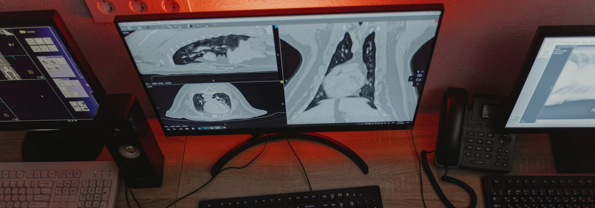

  

# 医学影像 × AI：可以一起做什么？

**有临床问题、有影像数据，但不知道怎样结合 AI？可以从下面这些方向开始。**

从数据整理、影像处理到建模验证，我可以协助把临床想法拆成具体的技术任务，形成能检查、能复核的结果。

你不需要先学编程。先聊想解决什么问题，再看现有资料适合做什么。

**[看合作方向](#可以合作的六个方向)** · **[看我能提供的支持](#我能提供哪些技术支持)** · **[交流具体想法](#有想法可以直接聊)**

---

## 我能提供哪些技术支持？

- **把问题变成方案**：明确研究目标、需要的数据、合适的方法，以及怎样评价结果。
- **把数据接上算法**：协助数据清理、图像预处理、分割定量、特征提取与模型开发。
- **把结果做成可复核的材料**：整理分析流程、模型评估、结果图表和错误病例。

可以从一个环节开始，也可以讨论完整流程。具体范围根据资料、目标和双方分工确定。

## 可以合作的六个方向

以下为合作方向与应用示例，具体可行性和效果需要结合数据评估。

### 01 · 图像分割与自动定量

“病灶一个个勾，太费时间了。”

辅助勾画器官、肿瘤或其他目标结构，经医生修正后，批量提取体积、形态等指标，建立重复使用的测量流程。

**可以形成的结果**：可修改的分割轮廓、逐例测量表、误差与人工复核记录。

[看数据要求与示例 →](docs/scenarios.md#segmentation)

### 02 · 影像组学与鉴别诊断模型

“两类病变看着相似，影像里有没有可利用的差别？”

提取影像特征，结合病理等参考结果建立模型，比较影像组学、深度学习或临床变量等方案是否能为鉴别诊断提供额外信息。

**可以形成的结果**：特征数据、建模流程、与常规方法的比较和独立测试结果。

[看数据要求与示例 →](docs/scenarios.md#diagnosis)

### 03 · 疗效评估与随访变化分析

“治疗前后，除了最大径，还能比较什么？”

辅助匹配不同时间点的病灶，比较体积、形态或其他预先定义的指标，整理同一患者的变化轨迹。

**可以形成的结果**：前后对照图、变化曲线、逐例测量记录及群体分析。

[看数据要求与示例 →](docs/scenarios.md#follow-up)

### 04 · 风险分层与预后预测研究

“哪些患者更可能复发、进展，或者治疗反应更差？”

结合基线影像、临床变量和可靠的随访结局，研究风险分层，并与已有临床指标或模型比较。

**可以形成的结果**：风险模型、预测与实际情况的比较、验证图表及适用范围说明。

[看数据要求与示例 →](docs/scenarios.md#prognosis)

### 05 · 报告结构化与科研队列整理

“报告和病例不少，整理成能分析的队列很费劲。”

从已获授权、完成脱敏的报告或记录中提取部位、征象、测量值等字段，辅助筛选病例、整理变量和检查缺失。

**可以形成的结果**：带原文依据的结构化草稿、队列候选清单和待核查项目。

[看数据要求与示例 →](docs/scenarios.md#reports)

### 06 · 动态与功能影像分析

“动态影像里，除了看形态，还能提取什么？”

围绕明确的临床问题，开展区域分割、跨时相追踪、时间曲线提取和参数计算，按任务选择 AI 或常规分析方法。

**可以形成的结果**：动态曲线、参数图、定量指标及质量控制记录。

[看数据要求与示例 →](docs/scenarios.md#dynamic)

## 我有这些资料，可以从哪开始？

- **只有一个临床想法**：先说明“想帮助谁、解决哪个判断、现在怎么做”。[把想法写成一页简报](templates/project-brief.md)。
- **有影像，还没有标注或结局**：先盘点序列、质量和可用资料，讨论定量、标注或可行性分析。暂不预设能做预测。
- **有影像，也有病理或诊断依据**：可以进一步讨论鉴别诊断研究，先明确参考标准和纳入人群。
- **有治疗前后影像，或完整随访**：可以讨论变化分析、疗效或预后研究，先核对时间点和结局。
- **有报告与临床记录**：可以先从字段整理、队列筛选和人工复核流程开始。

**病例数量只是一部分**。资料是否匹配、结局是否可靠、能否留出独立测试数据，往往更先决定项目能否启动。[看合作前要对齐的事情 →](docs/collaboration.md)

## 合作可以怎样开始？

**临床侧**：提出问题，确定病例范围、参考标准，参与标注复核和临床解释。

**技术侧**：协助数据处理、算法与模型实现、分析流程记录、验证和图表整理。

先对齐问题与资料，再试做关键环节；可行后确定完整方案和分工。[看具体流程 →](docs/collaboration.md)

## 有想法，可以直接聊

不必先写完整课题书。第一封邮件说明这三件事就够了：

1. **我想解决什么问题**？例如某类病灶难以区分、某项测量反复耗时。
2. **目前有什么资料**？影像类型、大致例数、是否有标注、病理或随访。
3. **希望先得到什么**？一套定量流程、可行性判断，或一份研究方案。

邮件：[jian_ma2021@163.com](mailto:jian_ma2021@163.com?subject=医学影像AI交流)

[复制一页项目简报 →](templates/project-brief.md)

首次联系只需资料概况，**请勿通过邮件或公开 Issue 发送可识别患者的影像、报告或病历**。具体资料的使用与交换，应在确认授权和合适渠道后进行。

---

[场景详解](docs/scenarios.md) · [合作怎么开始](docs/collaboration.md) · [工具与可信阅读](docs/resources.md) · [内容建议与问题反馈](https://github.com/Mj-usst/-/issues)

本文用于合作方向交流。科研模型需独立验证，研究结果不直接构成个体诊疗建议。封面为图库示意照片，摄影：<a href="https://www.pexels.com/photo/a-person-using-a-computer-to-diagnose-an-image-6235053/">Tima Miroshnichenko / Pexels</a>，<a href="https://www.pexels.com/license/">图片许可</a>。
