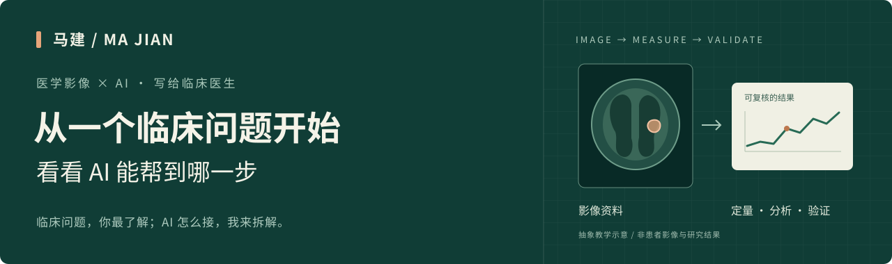

  

# 你手里的影像，还能回答什么问题？

**我是马建。这里聊医学影像与 AI，写给每天看图、写报告、做科研的临床医生。**

临床问题，你最了解；AI 怎么接，我来拆解。从反复勾画一处病灶，到整理一批随访病例，再到验证一个诊断或预后问题，我们先看具体任务，再选合适的方法。

不需要先学编程。带着一个问题来，就可以开始交流。

**[找一个与你相近的场景](#从你的日常工作开始)** · **[看看手里的数据能做什么](#我有这些资料可以从哪开始)** · **[联系马建](#带着一个问题来聊聊)**

---

## 从你的日常工作开始

下面是用于说明思路的**教学场景**，并非本人已完成项目或已验证的临床产品。实际能做到哪一步，要看数据、任务和验证结果。

### 01 · “病灶一个个勾，太费时间了。”

可以探索用 AI 辅助勾画器官或病灶，经医生修正后，批量提取体积、形态等指标。

**得到什么：**可复核的轮廓、定量结果，以及哪些病例需要人工处理的清单。
[展开：需要什么数据，怎样判断勾得好不好 →](docs/scenarios.md#segmentation)

### 02 · “两类病变看着相似，影像里有没有可利用的差别？”

把影像特征与病理等参考结果对应，研究能否在现有临床判断之外提供额外信息。

**得到什么：**有对照、有独立测试的研究结果，判断模型是否值得继续验证。
[展开：从鉴别诊断问题到研究任务 →](docs/scenarios.md#diagnosis)

### 03 · “治疗前后，除了最大径，还能比较什么？”

辅助匹配不同时间点的病灶，比较体积、形态或其他预先定义的指标，让变化更容易复核。

**得到什么：**逐例变化记录、对比图和测量结果；疗效结论仍需结合相应标准与临床资料。
[展开：随访分析怎样做得可靠 →](docs/scenarios.md#follow-up)

### 04 · “哪些患者更可能复发，或者治疗反应更差？”

将治疗前影像与临床信息结合，研究特定时间范围内的结局风险，并与常规临床模型比较。

**得到什么：**模型能否区分高低风险、预测概率是否接近实际情况，以及独立验证结果。
[展开：为什么随访和结局定义很关键 →](docs/scenarios.md#prognosis)

### 05 · “报告和病例不少，整理成能分析的队列很费劲。”

辅助从已获授权、完成脱敏的文本中提取部位、征象、测量值等字段，供人工核对和整理。

**得到什么：**带原文出处的结构化草稿、缺失项和待确认清单。
[展开：怎样避免把 AI 写出的内容当成事实 →](docs/scenarios.md#reports)

### 06 · “动态影像里，除了看形态，还能提取什么？”

围绕明确的生理或临床问题，探索区域分割、时间曲线提取和参数计算；必要时再引入 AI。

**得到什么：**可追溯的曲线、参数图及质控记录；是否有临床意义，需要单独验证。
[展开：动态与功能影像的研究起点 →](docs/scenarios.md#dynamic)

## 我有这些资料，可以从哪开始？

- **只有一个临床想法：**先说明“想帮助谁、解决哪个判断、现在怎么做”。[把想法写成一页简报](templates/project-brief.md)。
- **有影像，还没有标注或结局：**先盘点序列、质量和可用资料，讨论定量、标注或可行性分析。暂不预设能做预测。
- **有影像，也有病理或诊断依据：**可以进一步讨论鉴别诊断研究，先明确参考标准和纳入人群。
- **有治疗前后影像，或完整随访：**可以讨论变化分析、疗效或预后研究，先核对时间点和结局。
- **有报告与临床记录：**可以先从字段整理、队列筛选和人工复核流程开始。

**病例数量只是一部分。**资料是否匹配、结局是否可靠、能否留出独立测试数据，往往更先决定项目能否启动。[看合作前要对齐的事情 →](docs/collaboration.md)

## 在这里，我希望和你一起做什么？

我关注的是**把临床问题拆成可以实施、可以检验的影像 AI 任务**：先讨论问题是否值得做，再厘清数据、分析路线和验证方式。

你提供临床判断、研究问题和参考标准；技术环节围绕数据整理、影像定量、模型开发与结果复核展开。具体分工和交付范围，在看过资料概况后共同确定。

## 医生常问的几个问题

<strong>我不会代码，能参与吗？</strong>

能。临床问题、病例选择、标注规则、参考标准和结果解释，都需要医生参与。你不需要先成为程序员；先把问题说清楚，比先选模型更有用。

<strong>做医学 AI，是不是一定要训练一个大模型？</strong>

不一定。已有工具、传统图像处理或统计方法可能就能解决任务。是否需要训练模型，要与更简单的方案比较后决定。[工具与阅读入口](docs/resources.md)解释了几种常见选择。

<strong>有几百例，就一定能做吗？</strong>

没有通用的启动门槛。任务难度、阳性或结局事件数、数据质量、标注成本和验证方案都会影响可行性。先看资料结构，再评估样本与工作量。

<strong>科研模型做好了，就能直接用于临床吗？</strong>

科研表现不等于临床可用。还需要针对目标人群和真实流程验证，并满足拟用场景的机构要求与适用监管要求。本文讨论应用与研究思路，不提供个体诊断。

## 带着一个问题来聊聊

不必先写完整课题书。第一封邮件说明这三件事就够了：

1. **我想解决什么问题？**例如某类病灶难以区分、某项测量反复耗时。
2. **目前有什么资料？**影像类型、大致例数、是否有标注、病理或随访。
3. **希望先得到什么？**一套定量流程、可行性判断，或一份研究方案。

**马建 · Ma Jian**
邮件：[jian_ma2021@163.com](mailto:jian_ma2021@163.com?subject=医学影像AI交流)
[复制一页项目简报 →](templates/project-brief.md)

首次联系只需资料概况，**请勿通过邮件或公开 Issue 发送可识别患者的影像、报告或病历**。具体资料的使用与交换，应在确认授权和合适渠道后进行。

---

[场景详解](docs/scenarios.md) · [合作怎么开始](docs/collaboration.md) · [工具与可信阅读](docs/resources.md) · [内容建议与问题反馈](https://github.com/Mj-usst/-/issues)

马建 · 医学影像 × AI｜从临床问题出发，把可能性讲清，把结果做实。
